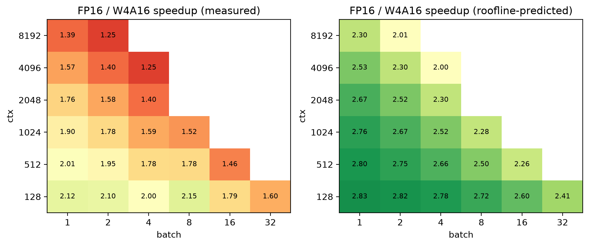
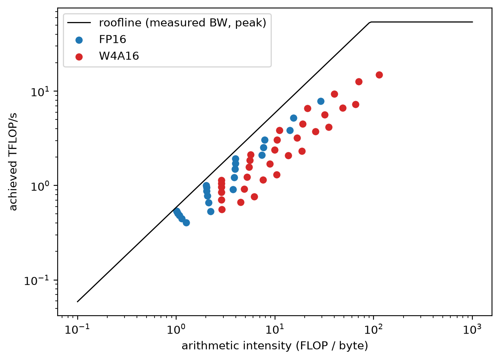
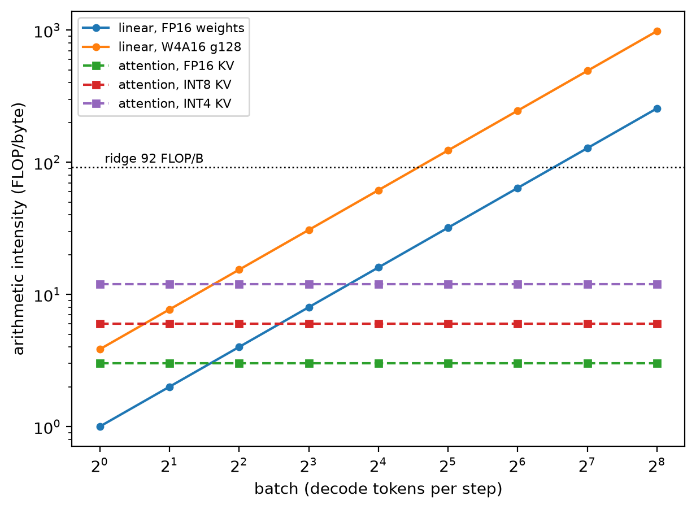

# Where does AWQ's decode speedup erode? RTX 2080 Ti characterization

Decode-step latency of Llama-3.2-3B-Instruct (GQA) on an RTX 2080 Ti (Turing, sm_75), FP16 vs W4A16, across batch size
and context length, compared against a roofline model. Course project; this is the Stage 1 characterization. KV-cache
quantization (Stage 2) and the serving-mode study (Stage 3) are not started.

Setup and reproduction: [SETUP.md](SETUP.md). Full HF-eager tables and the long vLLM table: [docs/results_full.md](docs/results_full.md).

## What was measured
- **Engine and kernels:** vLLM 0.31.0 (torch 2.13.0+cu129). W4 linear layers run vLLM's `MarlinLinearKernel`, which works on
  sm_75 in this version. Attention is `TRITON_ATTN` for both models (FlashAttention and FlashInfer don't support Turing).
  FP16 KV cache, CUDA graphs on, prefix caching off.
- **W4A16 model:** llm-compressor AWQ, 4-bit asymmetric weights, group size 128, `lm_head` kept in FP16; 2.2 GB checkpoint
  (FP16 weights are 6.4 GB).
- **Metric:** decode step time = (time for 129 generated tokens - time for 1 token) / 128, median of 3, 3 repeats per cell.
  Grid: batch 1-64 x ctx 128-8192. FP16 and W4A16 were run on the same node in one job (worst repeat spread 2.1%).
- **Hardware calibration:** read bandwidth 588 GB/s (95% of the 616 GB/s spec); FP16 GEMM peak 54.1 TFLOP/s (48% of the
  113.8 in the proposal). Ridge point ~92 tokens for FP16 weights and ~24 for W4A16 quantized linears (derived, ignores
  dequantization cost). The proposal's 185 and 740 were wrong: 4-bit weights lower the ridge, they don't raise it.

## Headline result: the measured speedup erodes faster than the roofline predicts

| ctx | batch | FP16 ms | W4A16 ms | measured | roofline-predicted |
|---|---|---|---|---|---|
| 128 | 1 | 12.07 | 5.69 | 2.12x | 2.83x |
| 128 | 32 | 26.43 | 16.48 | 1.60x | 2.41x |
| 2048 | 1 | 14.80 | 8.42 | 1.76x | 2.67x |
| 4096 | 4 | 34.36 | 27.41 | 1.25x | 2.00x |
| 8192 | 1 | 22.91 | 16.50 | 1.39x | 2.30x |

23 (ctx, batch) cells ran on both models; the rest are in `bench/results_vllm/` and `bench/plots/speedup.png`.
Another 9 cells fit only with W4A16 (the KV pool is about 3.0x larger: 53,312 vs 17,536 tokens). They count as capacity
gains, not speedups.

## Findings
- **The roofline overpredicts everywhere.** Predicted speedup is 2.0-2.8x on every cell. Measured is 2.15x at best and
  falls to 1.25x.
- **Step time tracks total KV tokens (batch x ctx).** FP16 at 8192 KV tokens takes 23.5, 23.8 and 22.9 ms for
  (2048,4), (4096,2) and (8192,1).
- **Attention is the context cost, and weight quantization doesn't touch it.** Nsight Systems at (8192, b=1):
  `kernel_unified_attention` takes 12.06 ms (FP16) and 12.08 ms (W4A16). That's 51% of the FP16 step and 70% of the
  W4A16 step.
- **Attention is slow for what it moves.** It takes 7.5-9x the ideal KV read time (about 11-13% of measured bandwidth),
  at a roughly constant 1.5-1.8 us per KV token from 4 sequences to 32. This points to a kernel limited per token, not by
  bandwidth. It's a hypothesis: GPU counters were unavailable.
- **FP16 GEMMs get slower at b=8.** At ctx 128, going from b=4 to b=8 moves one linear per layer from a CUTLASS kernel
  (~102 us) to a cuBLAS kernel (~261 us). That explains FP16's +3.45 ms jump, and why W4A16's speedup rises there.
- **Operator arithmetic intensity:** FP16 linear ≈ batch; W4A16 linear ≈ 3.85 x batch; GQA attention = 3 FLOP/byte
  (6 with INT8 KV). Attention never reaches the ridge, so it's memory-side at any batch.

## Caveats
- vLLM step time includes scheduler overhead; kernel sums from Nsight agree with the grid within 4% (`bench/check_nsys.py`).
- The roofline counts only weight and KV bytes (lower bound). W4A16 weight bytes are the checkpoint size, including the
  FP16 embedding/`lm_head`.
- GQA model only (the MHA model hasn't been run in vLLM). One node per run.
- Marlin's gap from the roofline wasn't profiled. Nsight Compute is blocked on this cluster (`ERR_NVGPUCTRPERM`).
- The older HF-eager baseline (`docs/results_full.md`, sections 1-7) can't be compared directly with the vLLM numbers.

## Layout
| Path | Contents |
|---|---|
| `bench/bench_vllm.py` | vLLM decode-step harness (FP16 or W4A16) |
| `bench/quantize_w4a16.py` | llm-compressor AWQ quantization |
| `bench/analyze_roofline.py`, `arithmetic_intensity.py` | Roofline, speedup maps, arithmetic intensity (CPU only) |
| `bench/nsys_cell.py`, `check_nsys.py`, `nsys/` | Nsight Systems capture, cross-check against the grid, kernel tables |
| `bench/bench_decode.py`, `calibrate.py`, `kernel_names.py`, `summarize.py` | HF-eager harness and hardware calibration |
| `bench/results_vllm/`, `bench/results/`, `bench/plots/` | vLLM and HF-eager raw results, plots |
| `requirements/`, `scripts/` | Pinned environments, install and grid job scripts |

## Status
| Item | State |
|---|---|
| FP16 HF-eager baseline, calibration | Done |
| W4A16 quantization, vLLM FP16 vs W4A16 grid (GQA) | Done |
| Arithmetic intensity, roofline and speedup plots | Done |
| Nsight Systems (5 cells) | Done |
| Nsight Compute | Blocked (counter permissions) |
| AutoAWQ | Dropped (deprecated) |
| TinyChat, vLLM native `awq` kernel, MHA model in vLLM | Not tried |
| Stage 2 (INT8/INT4 KV kernels), Stage 3 (chunked-prefill serving study) | Not started |
