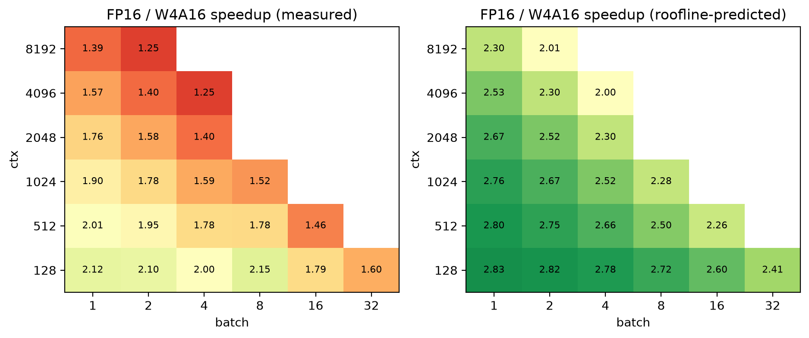
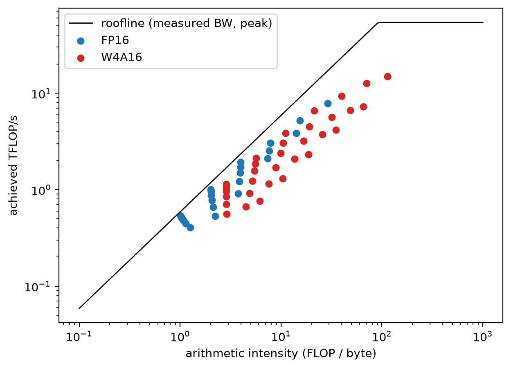
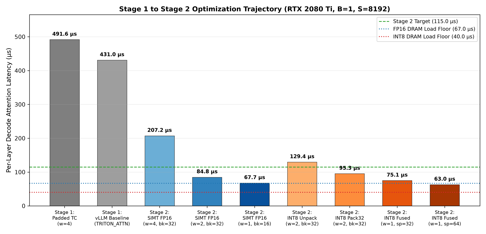
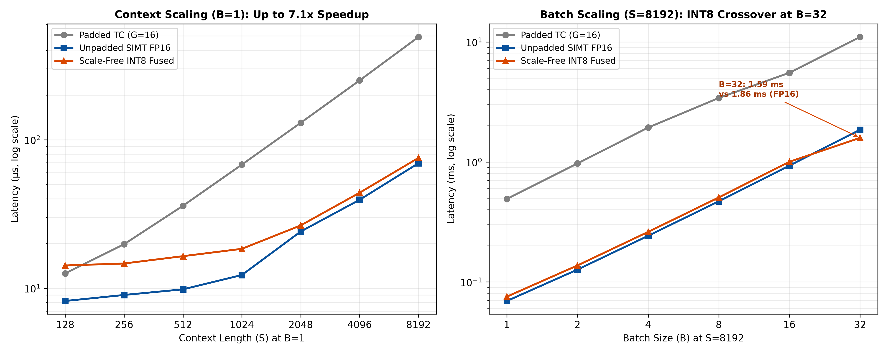

# Accelerating GQA Decode Attention on Turing (RTX 2080 Ti)

Characterization and kernel-level acceleration of Llama-3.2-3B-Instruct (GQA: `G=3`, `D=128`, 28 layers) decode attention on an RTX 2080 Ti (Turing, `sm_75`). Course project covering **Stage 1** (AWQ W4A16 roofline characterization) and **Stage 2** (unpadded SIMT & scale-free Hadamard INT8 Triton kernels). The serving-mode study (Stage 3) and end-to-end vLLM runtime integration are not started.

Setup and reproduction: [SETUP.md](SETUP.md). Stage 1 full tables: [docs/results_full.md](docs/results_full.md). Stage 2 compiler and kernel logs: [docs/stage2_findings.md](docs/stage2_findings.md).

## Stage 1: Where AWQ's Decode Speedup Erodes

- **Engine and kernels:** vLLM 0.31.0 (`MarlinLinearKernel` for W4A16 linears, `TRITON_ATTN` for attention; FlashAttention/FlashInfer do not support `sm_75`). FP16 KV cache, CUDA graphs on, prefix caching off.
- **W4A16 model:** llm-compressor AWQ, 4-bit asymmetric weights, group size 128, `lm_head` in FP16 (2.2 GB vs 6.4 GB FP16).
- **Hardware calibration:** Read bandwidth `588 GB/s` (95% of 616 GB/s spec); FP16 GEMM peak `54.1 TFLOP/s`. Ridge point ~92 tokens for FP16 weights and ~24 for W4A16 linears.

| ctx | batch | FP16 ms | W4A16 ms | measured | roofline-predicted |
|---|---|---|---|---|---|
| 128 | 1 | 12.07 | 5.69 | 2.12x | 2.83x |
| 128 | 32 | 26.43 | 16.48 | 1.60x | 2.41x |
| 2048 | 1 | 14.80 | 8.42 | 1.76x | 2.67x |
| 4096 | 4 | 34.36 | 27.41 | 1.25x | 2.00x |
| 8192 | 1 | 22.91 | 16.50 | 1.39x | 2.30x |

Nsight Systems at `(8192, b=1)` showed `kernel_unified_attention` takes `12.08 ms` (70.3% of W4A16 GPU kernel time), moving data at only 11–13% of the 588 GB/s DRAM bus (`431 µs/layer` in vLLM, `289 µs/layer` in standalone padded split-KV `kv_attn.py`). Meanwhile, naive INT8 KV quantization yielded `0%` speedup (`289 µs -> 303 µs`) despite lowering the pure DRAM load floor (`kv_loadonly.py`) from `67 µs` to `40 µs`.

## Stage 2: Eliminating the Tile Tax & Scale-Free INT8 Kernels

Using `ptxas -v --gpu-name=sm_75` (`bench/step0_compiler_diag.py`) and CUDA Graph replay (`bench/step0_timing_diag.py`, `bench/full_sweep_eval2.py`), we isolated two root causes and built unpadded Triton kernels:

1. **Tensor Core Tile Tax & Register Spill Cliff:** Padding `G=3` query heads into `tl.dot` (`BLOCK_G=16`) wastes 81.2% of compute rows. Increasing `BLOCK_G` to 32 hits 255 regs/thread with `664 B` spill stores; `BLOCK_G=64` forces 72 regs/thread with `4,700 B` spill stores and crashes latency 8.7x (`429.81 µs -> 3,765.76 µs`).
2. **1-Warp Unpadded SIMT (`src/simt_attn.py`):** Replacing `tl.dot` with unpadded vector dot products at `num_warps=1, BLOCK_K=16` drops registers to `168` (`0` spills), eliminates cross-warp `bar.sync` barriers, and reaches **`67.68 µs/layer`** (`495.8 GB/s` = 84.3% DRAM bus efficiency, within `0.68 µs` of the `67.0 µs` load floor).
3. **Scale-Free Packed-INT32 Hadamard Attention (`src/scale_free_int8_attn.py`):** Applies Post-RoPE Hadamard-128 rotation (`src/hadamard_utils.py`), fuses static channel scales `s_k` into `Q` inside Stage 1, reads KV as packed `int32` words to prevent 1-byte LSU stalls, and unpacks lane-by-lane to `fp16` (`237` regs, `0` spills), reaching **`62.96 µs/layer`** (`sp=64`).

### Verified Microbenchmark Summary (`B=1, S=8192`, CUDA Graph Replay)

| Configuration | `bk` | `w` | `splits` | Regs | Spills | Graph Latency (µs) | Eff. BW | Speedup | Max Err vs PyTorch |
|---|---|---|---|---|---|---|---|---|---|
| Padded Tensor Core (`G=16`) | 32 | 4 | 32 | 202 | 0 B | 491.60 | 68.3 GB/s | 1.00x | - |
| Unpadded SIMT FP16 | 32 | 4 | 32 | 168 | 0 B | 207.24 | 161.9 GB/s | 2.37x | `6.87e-5` |
| Unpadded SIMT FP16 | 16 | 1 | 32 | 168 | 0 B | **67.68** | **495.8 GB/s** | **7.26x** | `6.87e-5` |
| Scale-Free INT8 Unpacked (`fp32`) | 32 | 2 | 32 | 255 | 0 B | 129.45 | 129.6 GB/s | 3.80x | `9.77e-4` |
| Scale-Free INT8 Pack32 Unfused | 32 | 2 | 32 | 240 | 0 B | 95.27 | 176.1 GB/s | 5.16x | `9.77e-4` |
| Scale-Free INT8 Pack32 Fused `s_k` | 16 | 1 | 32 | 237 | 0 B | 75.12 | 223.3 GB/s | 6.54x | `9.77e-4` |
| Scale-Free INT8 Pack32 Fused `s_k` | 16 | 1 | 64 | 237 | 0 B | **62.96** | **266.5 GB/s** | **7.81x** | `9.61e-4` |

Across a 42-cell sweep (`B in [1..32] x S in [128..8192]`, `results/csv/eval2_full_2d_grid.csv`), speedup peaks at **`8.12x`** (`B=16, S=2048`), and at `B=32, S=8192` INT8 cuts per-layer latency from `10.99 ms` to `1.59 ms` (`6.92x`, beating SIMT FP16 at `1.86 ms`).

## Caveats
- Nsight Compute (`ncu`) is blocked on this cluster (`ERR_NVGPUCTRPERM`); Stage 2 register/spill data comes from `ptxas -v --gpu-name=sm_75`.
- Stage 2 latencies are standalone Triton microbenchmarks on synthetic `float16` tensors inside CUDA Graphs, not yet integrated into vLLM's end-to-end decoder loop.
- Hadamard + Scale-Free INT8 numerical parity (`9.61e-4` max abs error) is verified on synthetic tensors; Wikitext-2 perplexity with Hadamard rotation on real Llama-3.2-3B weights (`10–18x` Key outlier channels) is not yet measured.
- Stage 1 caveats (`docs/results_full.md`, vLLM scheduler overhead, Marlin gap) still apply to the vLLM grid.

## Layout
| Path | Contents |
|---|---|
| `src/` | Unpadded SIMT FP16 (`simt_attn.py`), Hadamard utils (`hadamard_utils.py`), Scale-Free INT8 (`scale_free_int8_attn.py`), load ceiling (`kv_loadonly.py`), outlier check (`real_kv_quant.py`) |
| `baseline/reference_impl/` | vLLM harness (`bench_vllm.py`), HF-eager harness (`bench_decode.py`), padded split-KV baseline (`kv_attn_padded.py`) |
| `bench/` | Stage 2 diagnostics (`step0_compiler_diag.py`, `step0_timing_diag.py`, `explore_cudagraphs.py`), full 2D sweep (`full_sweep_eval2.py`), plotting scripts |
| `results/csv/`, `results/plots/` | Stage 2 ablation matrix, 42-point 2D grid CSVs, evolution and scaling plots |
| `docs/` | Detailed Stage 1 (`results_full.md`) and Stage 2 (`stage2_findings.md`) documentation |

## Status
| Item | State |
|---|---|
| Stage 1: Calibration, vLLM FP16 vs W4A16 grid, Nsight Systems, roofline plots | Done |
| Stage 2: Step 0 compiler/spill proof (`ptxas`), CUDA Graph diagnostics | Done |
| Stage 2: Unpadded 1-warp SIMT FP16 & Scale-Free Packed32 INT8 Triton kernels | Done |
| Stage 2: Step 0–4 ablation matrix & 42-point `(B, S)` 2D sweep | Done |
| Stage 2: Wikitext-2 PPL validation with Hadamard rotation on Llama-3.2-3B | Next |
| Stage 2/3: vLLM end-to-end integration & chunked-prefill serving study | Not started |
