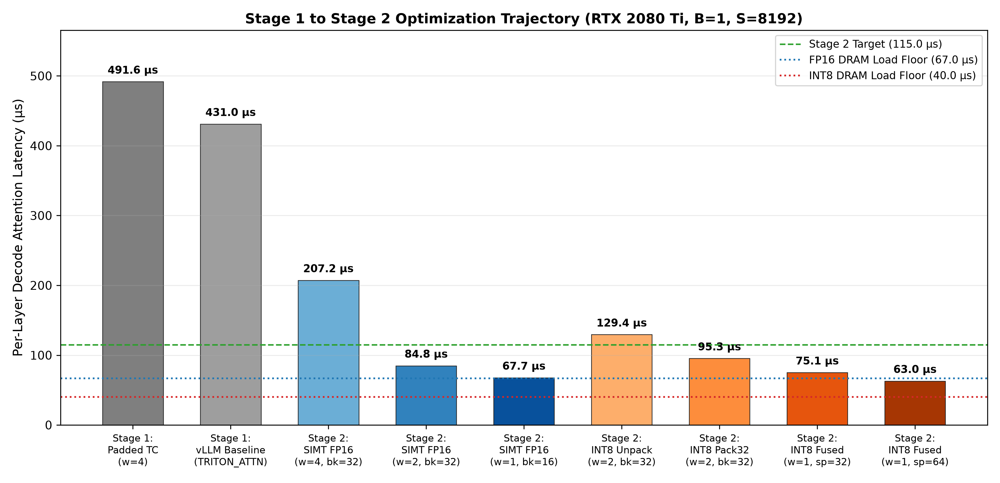
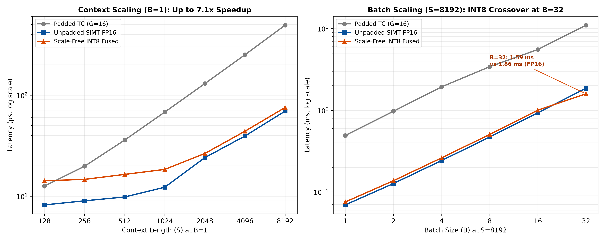

# Stage 2: GQA Decode Attention Optimization & Scale-Free INT8 Kernels

This document logs all verified experiments, compiler diagnostics, CUDA Graph checks, and kernel ablations performed on the RTX 2080 Ti (`sm_75`) following the Stage 1 characterization.

## 1. Summary of Root Causes Diagnosed (Step 0)

In Stage 1, Nsight Systems showed that `kernel_unified_attention` accounted for 70.3% (`12.08 ms`) of W4A16 decode time at `(ctx=8192, b=1)`, achieving only 11–13% of the 588 GB/s DRAM bus.

To isolate whether this was caused by Tensor Core padding waste or register spilling (without Nsight Compute counters, which are blocked on the cluster by `ERR_NVGPUCTRPERM`), we inspected Triton's generated PTX via `ptxas -v --gpu-name=sm_75` (`bench/step0_compiler_diag.py`) and timed eager vs CUDA Graph execution (`bench/step0_timing_diag.py`).

### Step 0A & 0B: Tile Sweep (`BLOCK_G`) vs Unpadded SIMT (`B=1, S=8192, splits=32`)

| Kernel Configuration | `BLOCK_G` | Regs / Thread | Spill Stores | Spill Loads | Eager (µs) | CUDA Graph (µs) | Graph BW |
|---|---|---|---|---|---|---|---|
| Padded Tensor Core | 16 | 205 | 0 B | 0 B | 493.42 | 429.81 | 78.1 GB/s |
| Padded Tensor Core | 32 | 255 | 664 B | 508 B | 462.16 | 461.76 | 72.7 GB/s |
| Padded Tensor Core | 64 | 72 | 4,700 B | 4,372 B | 3,885.21 | 3,765.76 | 8.9 GB/s |
| Unpadded SIMT FP16 (`w=4`) | 3 | 168 | 0 B | 0 B | 151.67 | 150.39 | 223.1 GB/s |
| Scale-Free INT8 (`w=4, unpacked`) | 3 | 237 | 0 B | 0 B | 167.52 | 166.73 | 100.6 GB/s |

Key findings from Step 0:
- At `BLOCK_G=16`, `tl.dot` pads `G=3` into 16 rows (81.2% idle rows). Increasing `BLOCK_G` to 32 hits the 255-register hardware limit and spills 664 B; `BLOCK_G=64` forces the compiler down to 72 regs/thread with 4,700 B of local memory spills, collapsing latency 8.7x to `3.77 ms`.
- Removing `tl.dot` in favor of unpadded SIMT vector reductions cuts registers to 168 (0 spills) and cuts graph latency from `429.81 µs` to `150.39 µs`.
- CUDA Graph capture removed up to `63.6 µs` of eager launch overhead on the baseline and reduced SIMT launch tax to `<= 1.28 µs`.

## 2. CUDA Graph Topology & In-Place Mutation (`bench/explore_cudagraphs.py`)

We verified that the 4-stage INT8 pipeline (`cuBLAS Q @ H` -> `mul s_k` -> `Triton Stage 1` -> `Triton Stage 2`) captures cleanly into a single CUDA Graph:
- **In-place input mutation:** Overwriting `q_base` in-place via `copy_()` updated outputs dynamically (`max delta = 0.0714–0.1028`) without graph recapture.
- **Zero memory churn:** Replaying the graph 100 times allocated `0 bytes` on the device.
- **Cluster limitation:** `graph.debug_dump()` triggered a PyTorch C++ warning (`DEBUG: calling debug_dump()`) but did not emit a `.dot` file on disk because Graphviz debug hooks were disabled in this prebuilt PyTorch binary.

## 3. Resolving the INT8 Bottleneck: Warp Count, Packed32 Loads, and Scale Fusion

Initially, `Scale-Free INT8 (w=4)` ran slower (`166.73 µs`) than `SIMT FP16 (w=4)` (`150.39 µs`) despite halving DRAM bytes. Three factors caused this:
1. **Cross-warp synchronization (`bar.sync`) & wave tail effects:** With `num_warps=4`, `tl.sum` reductions synchronize across 4 warps in shared memory on every tile step, and `cta/sm=2..3` forces 256 CTAs into 2 waves. Dropping to `num_warps=1` (32 threads/CTA) puts all reductions in warp-shuffle registers with zero `bar.sync` and fits `8–12 CTAs/SM`.
2. **1-byte load penalty:** Unpacked `int8` loads emit 1-byte transactions that throttle the Load-Store Unit (LSU). Viewing the contiguous `[B, S, H_KV, 128]` `int8` cache as `[B, S, H_KV, 32]` `int32` loads 4 channels per 32-bit word (`LDG.E.32`).
3. **Register lifetime & lossless FP16 unpacking:** Unpacking 1 byte-lane at a time (`((k_p << shift) >> 24).to(tl.float16)`) keeps live register usage under 255 (`237` regs at `bk=16, w=1`) with 0 spills and exact `9.61e-4` numerical parity, while absorbing static key channel scales `s_k` directly into `Q` inside Stage 1 eliminates the separate `torch.mul` node.

### Full Step 0–4 Ablation Matrix (`bench/full_sweep_eval2.py`, CUDA Graph, `B=1, S=8192`)

All raw rows are saved in `results/csv/eval2_ablation_matrix.csv`. Key milestones:

| Step & Configuration | `bk` | `w` | `splits` | Regs | Spills | `cta/sm` | Occ % | Max Abs Err | Graph (µs) | Eff. BW |
|---|---|---|---|---|---|---|---|---|---|---|
| Step 0: Padded TC (`G=16`) | 32 | 4 | 32 | 202 | 0 B | 2 | 25.0% | - | 491.60 | 68.3 GB/s |
| Step 1: SIMT FP16 | 32 | 4 | 32 | 168 | 0 B | 3 | 37.5% | `6.87e-5` | 207.24 | 161.9 GB/s |
| Step 1: SIMT FP16 | 32 | 2 | 32 | 254 | 0 B | 4 | 25.0% | `6.87e-5` | 84.85 | 395.5 GB/s |
| Step 1: SIMT FP16 | 16 | 1 | 32 | 168 | 0 B | 12 | 37.5% | `6.87e-5` | **67.68** | **495.8 GB/s** |
| Step 2: INT8 Unpacked (`fp32`) | 32 | 2 | 32 | 255 | 0 B | 4 | 25.0% | `9.77e-4` | 129.45 | 129.6 GB/s |
| Step 3: INT8 Pack32 Unfused | 32 | 2 | 32 | 240 | 0 B | 4 | 25.0% | `9.77e-4` | 95.27 | 176.1 GB/s |
| Step 4: INT8 Pack32 Fused `s_k` | 16 | 1 | 32 | 237 | 0 B | 8 | 25.0% | `9.77e-4` | 75.12 | 223.3 GB/s |
| Step 4: INT8 Pack32 KernelOnly | 16 | 1 | 32 | 237 | 0 B | 8 | 25.0% | `9.77e-4` | 70.76 | 237.1 GB/s |
| Step 4: INT8 Pack32 Fused `s_k` | 16 | 1 | 64 | 237 | 0 B | 8 | 25.0% | `9.61e-4` | **62.96** | **266.5 GB/s** |

## 4. Full 2D Batch & Context Sweep (`results/csv/eval2_full_2d_grid.csv`)

Swept all 42 cells across `B in {1, 2, 4, 8, 16, 32}` and `S in {128, 256, 512, 1024, 2048, 4096, 8192}` under CUDA Graphs:
- **Peak speedup:** `8.12x` at `(B=16, S=2048)` (`1,933.8 µs -> 238.1 µs` FP16) and `8.11x` at `(B=8, S=4096)`.
- **Batch crossover:** At `B=1, S=8192`, `SIMT FP16 (w=1)` reaches `69.4 µs` (`7.09x`) vs `INT8 Fused (w=1)` at `75.4 µs` (`6.52x`, including `q @ H`). At `B=32, S=8192` (1.07 GB FP16 KV footprint), DRAM saturation lets `INT8 Fused` (`1,587.8 µs`, `6.92x`) beat `SIMT FP16` (`1,855.5 µs`, `5.92x`) by `267.7 µs` (`14.4%` faster than FP16).

## 5. Pending Verification & Caveats
- All Stage 2 kernel latencies (`eval2_ablation_matrix.csv`, `eval2_full_2d_grid.csv`) are standalone microbenchmarks on synthetic Gaussian tensors (`torch.randn`), not yet integrated into vLLM's end-to-end `TRITON_ATTN` execution path.
- Numerical parity (`6.87e-5` FP16, `9.61e-4` INT8) was verified on synthetic tensors. Wikitext-2 perplexity with Post-RoPE Hadamard rotation on real Llama-3.2-3B weights (which exhibit `10–18x` Key channel outliers in `src/real_kv_quant.py`) is not yet measured.
- In `bench/full_sweep_eval2.py`, the inline `_padded_tc_stage2_kernel` helper omitted passing `l` from stage 1, causing its printed error check (`1.55`) to be uncalibrated; only its timing (`491.60 µs`) and `ptxas` stats (`202` regs, `0` spills) are reported.
